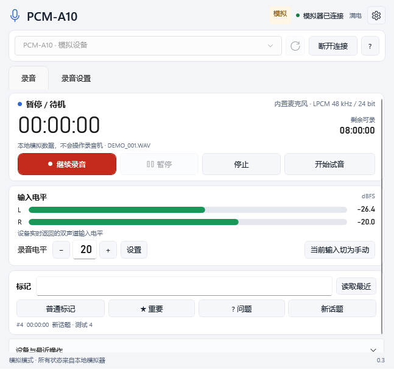
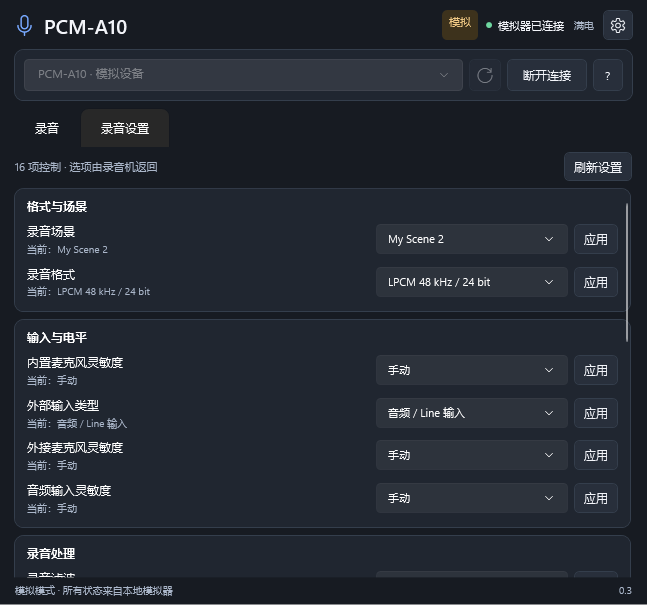

# 0.3.0 交付与验证

本次将原先宽大的桌面布局收紧为默认 **660×640**、最小 **600×520**。原默认 1080×810，默认窗口面积减少约 52%。录音、电平、直接增益、试音和四类标记集中在主页面；设备详情和历史记录默认折叠，完整录音设置放在第二个页签。浅色、深色与系统主题均保留。

新增 15 项录音设置、My Scene 1/2 保存、试音开始／结束、当前输入显式切手动、直接输入增益、四类自定义标记、最近标记与文件名读取，以及更完整的状态与设备通知。详细选项及边界见 [控制功能覆盖表](control-coverage.md)。

| 验证 | 结果 |
|---|---|
| 自动测试 | 52 项通过；包含协议与会话回归、真实能力 fixture、设置拒绝、实际值未变化、自动标记多步失败、试音互斥、四类标记、峰值原子更新、IPC 等 |
| 原生程序集成 | 调用已打包后端：15 项设置、My Scene 保存、试音、增益直设、四类 UTF-8 标记、最近标记、录音／暂停／继续／停止与文件名全部通过 |
| 能力一致性 | 模拟器的 21 项能力与此前捕获的真实 A10 能力逐项一致；可呈现 15 项普通设置与 1 项保存动作 |
| 紧凑界面 | 程序自身渲染预览，已检查浅色录音、深色录音、设置页及 600×520 最小窗口；小窗口内容可滚动 |
| 本轮实机 | 普通 Windows 进程连接返回 10049，未获得 Sony 控制通道；未执行设置更改、录音或预设覆盖 |
| 新功能实机验证边界 | 新增设置、试音、My Scene 的真实写入仍未完成；模拟自检不替代硬件证据 |
| 原有实机证据 | 仍保留此前录音、暂停、继续、停止、普通标记、时间、电池、双声道电平和增益拒绝的真实回执 |
| 发布 | 包含完整 C# / Python 源码和许可证；验证 ZIP CRC 与每个条目的 SHA256，排除原始日志及 Sony 原始材料 |

图像是应用自身在明确标注的模拟模式下渲染的预览，不是桌面截图或新功能的实机证明。生成方式与运行步骤记录于 `fluent-self-test.json`，此版本的详细机器结果见 `legacy-validation-0.3.0.json`；实机连接尝试见 `hardware-settings-validation-2026-10-26.json`。

使用 `Launch.cmd` 启动新版，`Demo.cmd` 启动模拟器。需保留随附的 runtime 目录，并安装 .NET 10 Windows Desktop Runtime x64（本机已有）；日常使用不需要额外安装 Python。窗口关闭只断开遥控，不停止设备录音。
