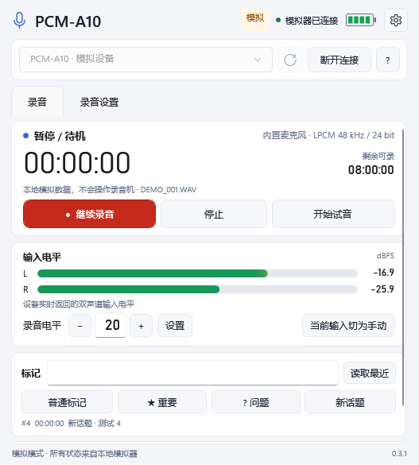

# 0.3.1 交付与验证

录音、暂停和继续合并为一个按钮：停止时显示「开始录音」，录音时显示「暂停录音」，暂停／待机时显示「继续录音」。后台先读取最新设备状态再选择操作。独立「停止」与「试音」保留；仅监听输入电平的待机入口放在右上角菜单和录音按钮右键菜单中。

默认窗口从 660×640 缩为 **540×620**，最小 **480×520**。窗口标题与页面标题均为 **PCM-A10**；模拟模式保留明确标识。原有 15 项设置、My Scene 保存、四类自定义标记和试音功能均保留。

主页面和设备详情使用同一个四格电池图标。三／四格绿色，两格黄色，一格红色；未知电量显示空灰格。充电时显示闪电，设备未报告档位时不伪造充电百分比。

关闭窗口会优先处理断开请求，不再排在正在等待的普通命令之后。未完成的连接可取消，迟到的连接也会关闭。前端只为自己启动的后端建立 Windows Job Object；窗口异常退出时会终止所属后端，释放其蓝牙句柄。后端已提前退出时，窗口也会等待当前关闭事件结束后再完成关闭，避免重复关闭异常。关闭不发送停止录音命令，不移除 Windows 配对记录。

真实测试曾在快速连续重连的第二次连接遇到 10060 超时，且当时没有遗留前后台进程、配对仍在。现在仅在 RFCOMM 建立失败时等待 1.2 秒重试一次；录音机协议命令尚未发送，因此不会重复录音、标记或设置操作。该历史失败保存在 [超时回执](hardware-reconnect-transient-2026-10-26.json)，本轮结果见 [重连回执](hardware-reconnect-2026-10-26.json)。

| 验证 | 结果与边界 |
|---|---|
| 自动测试 | 58 项通过；包含统一录音按钮的最新状态判断、连接取消、连接建立重试、关闭中断等待以及断开后重连 |
| 原生界面集成 | 已打包后端的模拟流程通过：15 项设置、My Scene、试音、直接增益、四类标记、开始／暂停／继续／停止、主题与最小窗口；同时检查原生进程退出码为 0 |
| 正常关闭 | 模拟录音中关闭：后端确认断开并退出，最终 ready=false，录音状态仍为 3；没有发送停止命令 |
| 异常退出 | 仅终止自己启动的模拟测试窗口，所属后端由 Job Object 自动退出；未接触真实录音机 |
| 实机 | 新界面已连接真实 A10 并通过原生关闭按钮退出；关闭后重新连接原有配对设备成功。修正重连超时后的连续两轮结果见重连回执 |
| 界面 | 已检查浅／深色主页面、设置页、480×520 最小窗口及电池颜色；预览由程序自身的模拟内容渲染 |
| 发布包 | 包含完整源码和许可证，校验 ZIP CRC 与每个归档条目的 SHA256；不包含原始通信日志、Sony 原始材料或旧 Tk 运行库 |

机器结果见 [validation.json](validation.json)、[原生界面自检](fluent-self-test-0.3.1.json) 和 [异常退出回执](lifecycle-check-0.3.1.json)。0.3.0 的历史结果保留为 [legacy-validation-0.3.0.json](legacy-validation-0.3.0.json)。

实机重连测试只枚举已配对设备、连接读取状态并关闭，不修改设置、预设或录音状态。新增设置、试音和 My Scene 的实机写入、录音文件试听以及长时间无线连接仍未验证。日常使用继续双击 `Launch.cmd`，需安装 .NET 10 Windows Desktop Runtime x64；Python 后端已随包附带。
